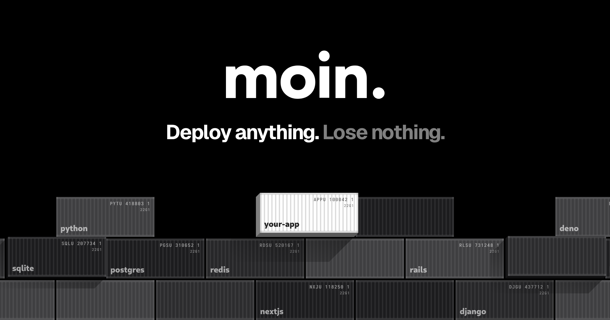

<p align="center">
  
</p>

Deploy anything. Lose nothing. Your apps on your servers. Backups on your schedule. Checked every day. For SQLite and Postgres, with web, CLI, terminal UI and MCP.

All of moin is open source, in this repo. The daemon runs as root on your server, and you can read every line: [`internal/daemon`](internal/daemon). Host it yourself for free, with every feature.

```bash
moin login              # log in through the browser
moin servers add web-1  # prints the one-line install for your server
moin deploy             # ✓ moin. your app is live
moin                    # the live terminal UI
```

The daemon on your server only dials out. Nothing listens for moin.

## Documentation

Everything else is in the docs: [moin.run/docs](https://moin.run/docs), or `/docs` on your own hub. They are the source of truth.

News on X: [@usemoin](https://x.com/usemoin).

## Build

```bash
go install github.com/axadrn/moin/cmd/moin@latest
```

The hub is in [`hub`](hub).

## License

Open source: [what the licenses cover](https://moin.run/docs/faq#is-moin-open-source). See also [CONTRIBUTING.md](CONTRIBUTING.md). The license covers the code, not the name or the logo: see [TRADEMARKS.md](TRADEMARKS.md).
